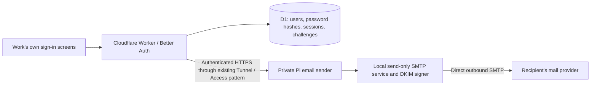

# Email sign-up and Pi email delivery plan

Planning document, 16 October 2026. The application, private sender, migrations, configuration tools and automated checks are implemented. Production now serves email/password authentication. A missing owner password credential was repaired and live sign-in verified on the existing account. The owner subsequently selected Gmail SMTP as the free Pi delivery transport; production is configured, and the owner confirmed a real recovery message arrived in the inbox. Direct-to-recipient delivery from the home connection remains unused. See [setup and cutover](email-auth-setup.md).

## Agreed direction

- Replace GitHub authentication completely; anyone may register.
- Keep Better Auth in the existing Cloudflare Worker, with authentication data in D1.
- Ask for email and password at sign-up, followed by a six-digit email verification code.
- Normal sign-in uses email and password. Password recovery uses an emailed six-digit code.
- Preserve the owner's existing `manav1411` account and workspace while moving it to the requested Gmail address. Supply the exact address privately during migration rather than committing it here.
- Investigate sending email directly from the Pi before choosing an email delivery service.
- Following that investigation, use the Pi mailer with Gmail SMTP and a privately stored App Password. The direct-delivery plan below records the earlier proposal and its unresolved ISP/DNS requirements.
- Build every screen in Work's own style: lively, simple, intuitive, and consistent with the rest of the site.

The Pi runs the email sender and submits through Gmail; the authentication location remains Cloudflare. Passwords and verification codes must never appear in committed configuration, documentation, or logs. Set the owner's password privately through verified account setup.

## Architecture and alternatives

The repository already has Better Auth 1.7.7, a Drizzle/D1 adapter, credential/password storage, verification storage, and secure cookie sessions. Its current GitHub restrictions appear in registration, account creation, session creation, and session resolution. All four boundaries must be updated.

[Better Auth's Email OTP plugin](https://better-auth.com/docs/plugins/email-otp) supports email verification and password recovery, with configurable code length, expiry, attempt limits, and protected storage. Use these capabilities behind custom Work forms. Do not expose passwordless OTP login simply because the plugin provides it. Verify configuration against the installed release; current online documentation may describe a newer release.

SuperTokens was considered. Its current [self-hosting guide](https://supertokens.com/docs/deployment/self-host-supertokens) adds a private Core service and PostgreSQL. Keeping the existing library and database avoids introducing that additional infrastructure. A separate paid authentication service is unnecessary for this plan; hosting and email costs still apply.

Proposed path if Pi delivery passes its checks:

Keep the sender separate from the existing Pi compiler service, with a dedicated service identity, secrets, and resource limits. Its private API accepts only bounded verification/reset email jobs from Work, rather than arbitrary public mail submissions. Pi outages would interrupt new verification and recovery emails; existing sessions and password sign-ins remain on Cloudflare.

## First milestone: establish whether direct Pi delivery is practical

This is a feasibility investigation before installation or DNS changes:

1. Identify the ISP, public address, whether it is static, and whether the connection uses CGNAT. Confirm the ISP permits running an outbound mail server and allows outbound TCP port 25.
2. Establish whether the ISP can set reverse DNS for the actual sending IP. Choose a mail hostname with matching forward DNS, PTR, and SMTP greeting.
3. Check the sending address's reputation and applicable policy listings. [Spamhaus explains](https://www.spamhaus.org/blocklists/policy-blocklist/) that residential/end-user address ranges can be unsuitable for direct SMTP delivery.
4. Select a dedicated sending address/subdomain, then plan SPF, DKIM, DMARC, TLS, and handling of delivery failures. [Gmail's sender requirements](https://support.google.com/mail/answer/81126?hl=en) cover authentication and valid forward/reverse DNS.
5. If feasible, configure a small send-only mail service, such as [Postfix](https://www.postfix.org/BASIC_CONFIGURATION_README.html), with DKIM signing. A full mailbox/webmail platform is unnecessary. Plan a valid return path and bounce processing without replacing existing mail routing.
6. Test real delivery to Gmail and Outlook, including authentication results, inbox placement, delay, and repeated sends. Agree on a delivery target substantially shorter than code expiry; a reasonable initial target is under one minute in normal conditions. Server acceptance alone is insufficient evidence of inbox delivery.

The existing Cloudflare Tunnel can protect the HTTP submission endpoint. It does not change the Pi's outbound SMTP source IP or remove ISP/reputation requirements. Cloudflare's [normal DNS proxy does not proxy SMTP](https://developers.cloudflare.com/dns/proxy-status/use-cases/).

If direct sending fails these checks, record the specific blocker before selecting another transport. A static IP or mail-capable server can introduce extra costs, so using the Pi is not automatically cheapest. Cloudflare's [Email Service](https://developers.cloudflare.com/email-service/get-started/send-emails/) is a possible alternative within existing hosting, but remains unselected. Its [current pricing](https://developers.cloudflare.com/email-service/platform/pricing/) requires Workers Paid for arbitrary recipients and includes 3,000 outbound emails per month, then US$0.35 per 1,000. Do not silently substitute it or another relay.

## Screens and behaviour

| Screen             | Inputs and result                                                                                                                                   |
| ------------------ | --------------------------------------------------------------------------------------------------------------------------------------------------- |
| Sign up or sign in | Shared email/password fields with equal-sized pink Sign in and turquoise Sign up buttons in one row. A divider separates the green See demo button. |
| Verify email       | Six-digit code; masked destination, edit-email action, resend countdown. Only successful verification allows workspace access.                      |
| Forgot password    | Email; same acknowledgement whether or not an account exists.                                                                                       |
| Reset password     | Six-digit recovery code and new password; validate both on submission, then return to sign-in.                                                      |

Use the current typography, colour palette, surfaces, focus states, buttons, responsive layout, and restrained motion. Extract auth screens from the large `App.tsx` as needed. Use accessible labels, inline errors, clear loading/success states, and consistent navigation. A code entry may look like six slots but must support full-code paste, leading zeroes, numeric mobile keyboards, autofill, and screen readers. Keep the existing demo entry accessible.

New accounts can use a neutral internal display name until the user sets one in Settings. Do not require a name just to satisfy the auth library's API. Never store passwords in browser persistence. The implemented password policy is 8–128 characters; allow password managers, paste, and long passphrases without arbitrary symbol rules.

Proposed code policy: six digits, five-minute expiry, five wrong attempts per challenge, and a 60-second resend cooldown. A resend replaces the previous code. Apply additional shared per-email and per-IP limits, plus sending quotas; resends must not provide unlimited guesses or email sends. Verification and recovery codes are separate and single-use. Protect stored codes with encryption or a keyed hash rather than plaintext.

## Authentication and account migration

1. Test password hashing and verification on the actual staging Worker, including realistic concurrency and its configured CPU/memory limits. Do not weaken password hashing to fit a hosting tier. Cloudflare publishes its [runtime limits](https://developers.cloudflare.com/workers/platform/limits/).
2. Enable email/password plus email verification/recovery. Preserve same-origin checks, secure HttpOnly cookies, host isolation, and database-backed session checks. Require verified email on private API requests as well as in the UI.
3. Replace GitHub-only hooks and configuration checks with the email account rules. Disable unused social, passwordless, and account-linking routes. Keep local development fixtures confined to local environments.
4. Reuse the existing auth tables where possible. Add migrations only for necessary challenge/rate-limit/delivery state; do not rewrite historical migrations. The existing broad IP throttle alone is insufficient for public sign-ups.
5. Before opening registration, identify the owner's actual existing user ID using its stored GitHub identity and check for an email conflict. Verify control of the requested mailbox, add a credential to that same user, and preserve every workspace/file ownership reference. Never create a replacement user or merge accounts solely because an unverified email matches.
6. The installed OTP reset implementation can create a missing credential for an existing user. Verify that behaviour through the real D1 adapter before using it for migration. Handle a GitHub private/noreply address through the explicit migration, not by assuming it can receive mail.
7. Prove the owner can sign in with email and recover the existing workspace before removing GitHub access. Revoke old sessions at the coordinated cutover, retire obsolete OAuth tokens/secrets, and update launch/security/operations documentation. GitHub repository integration and build connections are separate from user authentication.

## Email delivery, abuse controls, and failure recovery

Use one small email delivery interface so the application does not depend on a particular transport. A durable, bounded job queue should retain only the information needed to send a code, protect sensitive payloads, expire promptly, and avoid sending codes that have already expired or been replaced. Retry temporary delivery failures with backoff and deduplication. Record delivery status without logging codes or passwords. Surface a usable retry state when the Pi is unavailable; successful enqueueing is not successful delivery.

Bound unverified-account and challenge retention. Do not let an attacker preregister somebody else's email and leave an attacker-chosen password active when the mailbox owner later verifies. Bind pending registration to its initiating flow; recovery of an existing unverified registration must replace its password and revoke sessions after ownership is proven.

After password recovery, revoke all sessions and require a fresh sign-in. D1's adapter does not provide interactive multi-step transactions here. Test partial failures and concurrent requests explicitly: code consumption, password updates, and session revocation must never produce a false success or leave a usable old session after a reported successful reset. A failed operation may require a fresh code, with a clear recovery path.

## Implementation order and acceptance

1. Resolve Pi mail feasibility and delivery evidence; confirm sender address and password policy.
2. Prove the Worker password and D1 challenge behaviour in staging, including failure cases.
3. Implement email/password authentication, shared abuse limits, protected email delivery, and account verification boundaries.
4. Build and review the Work-styled screens on desktop and mobile.
5. Rehearse owner migration against a synthetic existing account; then prepare the private production migration and cutover.
6. Complete staging acceptance before production deployment.

Acceptance covers registration, verification, password login, reset, sign-out, expired/replaced/wrong/reused codes, simultaneous verification/reset attempts, resend limits, unverified API denial, registration recovery, email send failures, Pi downtime, session revocation, owner migration, and isolation between two users. Check real inbox delivery and deployed password runtime separately from mocked email tests. Existing data and file access must survive migration under the same owner ID.

Use the repository's relevant auth/integration/browser checks, type/lint checks, build, and runtime checks during implementation. This planning-only change does not require application tests.

## Still to establish

- Pi ISP, address type, outbound SMTP permission, reverse DNS, and delivery feasibility.
- Sending address/subdomain and return-path/bounce handling.
- The owner's privately chosen replacement password through verified recovery.
- Production was checked read-only: the pinned owner already has the requested destination email. Credential creation, actual recovery and final cutover remain pending mail readiness.
