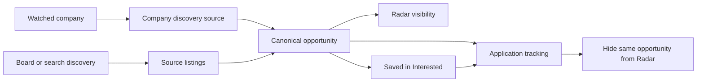

# Radar: research and implementation plan

Researched 16 October 2026 against the current repository and primary provider documentation. This document records the design and source research. The feature has since been implemented, tested with bounded provider pilots, and deployed to production during 16–17 October 2026; see [implementation and activation](radar-implementation.md) for current behavior, limits, and release verification. No real Radar email has been sent by the release checks. The existing changes in `docs/new-features.md` remain untouched.

## 1. Recommended direction and agreed requirements

Build Radar as a persistent opportunity discovery service with replaceable source adapters. Keep a canonical opportunity separate from the places it was advertised, the user's interest in it, and an application tracking it. This separation is the basis for deduplication and for keeping Interested, Radar, and Applications interconnected.

Confirmed during this discussion:

- Rename the current company watchlist to **Interested**. It will contain both watched companies and saved individual opportunities.
- **Radar** discovers opportunities and orders them primarily by predicted personal interest. It supports flagging, filtering, sorting, listing links, and creating an application with known fields filled in.
- An **About you** editor supplies qualifications, experience, and eligibility context. The user can write facts such as their role at Sportsbet or their stated E3 eligibility. Provide **Paste resume text** and **Use resume from Documents** actions.
- Job-data expenditure must remain **$0**. Generous free trials and recurring free allowances are acceptable when they suit the workflow. They must never turn into paid usage automatically.
- Hosted JEV usage may consume the existing **$5** balance. Filter and deduplicate first, combine independent judgments in one request, and reuse unchanged evaluations.
- Prefer presenting an uncertain opportunity over losing it. Unknown salary, closing date, qualifications, or eligibility must remain explicitly unknown.

Recommended first source mix: public employer ATS feeds and JSearch's free tier for broad discovery. Evaluate Apify's recurring free allowance specifically for gaps in LinkedIn/Indeed/SEEK coverage. Select the sources that actually contribute useful Australian and US jobs during a short measured pilot; do not build every integration before measuring them. **Adzuna is excluded:** the user's signup offers only 25 test calls and requires £8/month for ongoing access, which conflicts with the $0 source budget. Account-specific activation terms override the older public documentation cited below.

## 2. What exists in this repository

| Existing component | Finding | Consequence for Radar |
| --- | --- | --- |
| `src/features/search/ApplicationsPage.tsx` | Applications and a `tab=radar` company view share one page; the latter displays “On your radar.” | Split tab selection into Interested, Radar, and Applications without rewriting recruitment tracking. |
| `shared/applications.ts` | Strict application and company schemas; companies have careers URLs and applications can reference `companyId`. | Keep company records and IDs. Add opportunity relationships deliberately; arbitrary AI metadata cannot be appended to strict application data. |
| `src/features/search/InlineInterestedFields.tsx` | Company editing uses autosave and conflict handling. | Use Interested terminology and current draft keys. No old Radar draft migration is retained, as requested. |
| `src/components/CompanyGlyph.tsx` | Locally bundled, curated logos matched by employer name/domain; no external logo search. | Reuse this component and add an initials fallback for unknown employers. A board URL must not make a Google role display LinkedIn's employer logo. |
| `worker/index.ts`, `wrangler.jsonc` | Hono Worker, authenticated API, one-minute cron, and an explicit API route allowlist. | Add Radar routes to the allowlist and use short, persisted background tasks. Scheduling already exists. |
| `worker/auth-mail.ts`, `mailer/server.py` | Leased encrypted authentication email outbox and a private Pi/Gmail sender. Only OTP templates are accepted. | Reuse transport patterns, but implement a separate digest outbox/template. Existing auth messages must retain priority. |
| `worker/latex.ts` | Compiled documents can have private extracted-text attachments. | Import existing resume text when available; provide manual paste if extraction is unavailable. |
| `worker/transfer.ts`, `shared/transfer.ts` | Whole-workspace export/import, strict manifests, epoch and generation guards. | Radar's saved state and relationships must participate in export/import and workspace replacement. |
| `worker/db/records.ts`, `shared/references.ts` | Owner-scoped records and relationship/deletion rules. | New tables and cross-table links need equivalent ownership, deletion, and conflict checks. |
| `src/lib/workspace.tsx`, `/api/records` | The main workspace loads all ordinary records. | Keep scraped opportunities in dedicated, paginated tables instead of filling the workspace record list with thousands of listings. |
| `docs/jev-applications.md` | Earlier research, not a working JEV integration. | Build a small server-side JEV client; no existing scoring integration can be assumed. |

The initial investigation did not query live production infrastructure. Subsequent local pilots checked the configured providers and Apify's Free plan. Existing documentation describes production Gmail delivery; the new Radar template still requires deployment and a real delivery check.

## 3. Source research and the $0 constraint

Published allowances are current research findings, not measured performance or guaranteed future terms. A marketplace scraper is a third-party collector, not an official API of its target board. Accessible endpoints alone do not establish permission to use their data.

| Source | Verified interface / allowance | Proposed use and limitation |
| --- | --- | --- |
| Greenhouse | Published Job Board GET endpoints require no authentication; descriptions can be included. | First-wave connector for companies with known board tokens. Company-by-company coverage, not a global jobs search. [Documentation](https://docs.greenhouse.io/job-board) |
| Lever | Published postings API, namespaced by company, with descriptions, location/workplace fields, and optional salary ranges. | First-wave connector. No global full-text search across employers. [Documentation](https://github.com/lever/postings-api) |
| Ashby | Public job-board endpoint; optional compensation, workplace type, and secondary locations. | First-wave connector; only display `isListed=true` postings. [Documentation](https://developers.ashbyhq.com/docs/public-job-posting-api) |
| Adzuna — excluded | User reports Pending Activation with 25 test calls; ongoing access offered at £8/month for 5,000 calls/month and 500/day. | Do not integrate, upgrade, or use the test allowance for this MVP. Earlier public documentation did not establish the access actually offered to this account. [Public search documentation](https://developer.adzuna.com/docs/search) |
| JSearch, direct OpenWeb Ninja | Advertises a no-card free tier of 200 requests/month with a hard limit; returns Google-for-Jobs-derived results and publisher/application links. | Strong candidate for a small discovery pilot. Actual Australian coverage, SEEK representation, pagination yield, and request accounting need measurement. Prefer the direct free plan over marketplace plans with different billing. [Provider](https://www.openwebninja.com/api/jsearch) |
| Apify Free | $5 recurring monthly platform allowance, no card; free accounts stop when exhausted. | Candidate for targeted board collection inside that allowance. Actor result charges, run fees, and other platform usage compete for the same balance. [Pricing](https://apify.com/pricing) |
| SerpApi Free | 250 searches/month. Google Jobs interface includes pagination. | Alternative to JSearch for a focused discovery pilot; do not automatically run both against identical searches. [Pricing](https://serpapi.com/pricing), [Google Jobs interface](https://serpapi.com/google-jobs-api) |
| Brave Search | Search is $5/1,000 requests with $5 recurring monthly credits. | Potential low-frequency employer/page discovery, but its retention restrictions make it unsuitable as the initial persisted listing feed. [Pricing](https://brave.com/search/api/), [retention and billing FAQ](https://api-dashboard.search.brave.com/documentation/resources/help-feedback) |
| Employer careers pages | Some expose feeds, sitemaps, or `JobPosting` structured data. | Detect supported ATS first, then inspect permitted structured HTML. JavaScript-heavy/custom sites need separate adapters. [JobPosting fields](https://developers.google.com/search/docs/appearance/structured-data/job-posting) |
| Workday | Official integration APIs exist, but this research did not verify a general anonymous jobs-feed contract equivalent to the three ATS APIs above. | Later, employer-specific feasibility work. Do not call browser-facing career-site endpoints a supported public API. [Official API directory](https://community-content.workday.com/en-us/public/products/platform-and-product-extensions/soap-api-reference.html) |

**Adzuna research correction:** the public terms previously consulted list 25 requests/minute, 250/day, 1,000/week, and 2,500/month, but those numbers are not the user's granted allowance. The signup offer reported above governs this account. Adzuna also has attribution requirements and snippet limitations; these are historical research notes, not MVP implementation tasks. Reconsider only if genuinely ongoing $0 access becomes available. [Public terms](https://developer.adzuna.com/docs/terms_of_service)

**Free allowance versus trial:** a recurring allowance can support ongoing personal use; a one-time trial supports evaluation and then expires. Store renewal/expiry dates, reserved and used units, and a disabled-at-limit state per provider. The application must not create paid subscriptions, buy top-ups, enable automatic reloads, or rotate accounts to extend trials. An exhausted source pauses while other free connectors continue. Infrastructure uses the current Worker/D1/Pi/Gmail setup; no new paid infrastructure is assumed.

### LinkedIn, Indeed, and SEEK

- LinkedIn's documented talent APIs focus on recruitment integrations and job posting. No general self-serve jobseeker search API was verified. Its user agreement restricts automated scraping. [Talent APIs](https://learn.microsoft.com/en-us/linkedin/talent/), [user agreement](https://ac.linkedin.com/legal/user-agreement)
- Indeed's documented APIs are partner-oriented; its publisher search plugin is not a general server-side ingestion API. Automated access is restricted by its terms, including the permission described there for crawling under its robots rules. [Partner documentation](https://docs.indeed.com/), [terms](https://www.indeed.com/legal?co=US&hl=en)
- SEEK requires approved integration access, primarily for recruitment systems; its website terms restrict scraping without consent. [Developer site](https://developer.seek.com/), [website terms](https://au.seek.com/terms)

These findings change the delivery promise: aim to surface opportunities advertised on those boards, but do not make three working direct scrapers a prerequisite for the product or assume free, complete coverage.

**Apify feasibility candidates:** marketplace examples currently advertise LinkedIn collection at $0.49/1,000 results, SEEK from $0.70/1,000, and an Indeed collector at $0.003/listing plus $0.005/run. These are individual authors' advertised rates and capabilities, not independently tested endorsements. Confirm each selected Actor's Free-plan rates, Australian support, full-description output, data-use conditions, and all charges before selecting it. [LinkedIn example](https://apify.com/parsebird/linkedin-jobs-scraper), [SEEK example](https://apify.com/saswave/seek-scraper/api), [Indeed example](https://apify.com/automation-lab/indeed-scraper)

Illustrative allowance calculation using those advertised rates: three profiles × three boards × ten results/day × thirty days = 2,700 collected rows/month. At 900 rows per board, result charges would be about $0.44 + $0.63 + $2.70 = $3.77, before run fees, other platform charges, retries, and detail requests. This makes the free allowance worth testing, but does not establish that all three collectors fit or work reliably. Lower the query cadence or allocate targeted board runs if measured cost exceeds the allowance. Even duplicates can incur collection costs before Work deduplicates them.

**Self-hosted option:** JobSpy supports LinkedIn and Indeed, including Australian Indeed queries, but does not list SEEK. Its README documents blocking/rate limits and extra requests for descriptions. Treat it as a possible isolated Pi adapter, not a solution to all three boards. It does not remove source access restrictions or maintenance costs. [Project documentation](https://github.com/speedyapply/JobSpy/blob/main/README.md)

Search discovery can locate employer feeds that become cheap to poll directly. Keep `discoveredVia` separate from `publisher`: “LinkedIn, discovered through JSearch” is accurate; “direct LinkedIn API” would not be. Results must retain the actual listing destination. A source failure must be visible rather than reported as “no jobs.”

For a 30-day JSearch pilot, reserve 150 of the 200 advertised monthly requests for up to five first-page queries/day and 50 for pagination, manual pings, and retries. Example queries cover Melbourne software, Sydney software, Australian cybersecurity, Bay Area software, and New York software; remote variants can rotate rather than multiplying every query daily. This is an allocation proposal, not a claim that five queries provide complete coverage. Measure useful unique jobs per request and explicitly identify pagination truncation. Provider reset dates may differ from calendar months.

Apify adapters should pin the tested Actor build, inspect current pricing before starting, reserve allowance atomically, and set the supported per-run charge/item cap and timeout. Pay-per-event and pay-per-result caps have different semantics; they are additional controls alongside the Free account's monthly stop. [Run options](https://docs.apify.com/sdk/js/reference/next/interface/StartTaskOptions)

**Next source-validation step:** no additional API signup is required. Once the configured credentials are available, first validate provider identity/plan and selected Actor metadata without launching collection. Then use a bounded pilot: five JSearch searches for the five example queries; at most one small run per candidate board Actor, initially ten results each, with provider-supported charge limits and a total Apify pilot allowance of at most $0.25. Skip an Actor if its advertised minimum/run cost cannot fit. Keep source calls sequential and stop on unexpected billing, unsupported inputs, or exhausted quota. Compare original listing IDs, publisher links, Australian coverage, description completeness, duplicates, and net useful results. Only after deterministic filtering/dedup should a small sample reach JEV, with a separate proposed $0.01 pilot cap. These are planned limits, not API calls already performed or a claim that the credentials are validated.

Use `TYPESAFE_API_KEY`, `JSEARCH_API_KEY` (direct OpenWeb Ninja), and `APIFY_TOKEN` as server-side configuration names. An existing `APIFY_API_TOKEN` name may be mapped deliberately if needed; a RapidAPI JSearch key instead requires its own host/header configuration. Verify the provider rather than trying credentials against unrelated hosts. Greenhouse/Lever/Ashby need employer board URLs, not additional API credentials. SerpApi remains an optional later fallback, not a required signup.

## 4. Interested, Radar, and Applications

Suggested tab order: **Interested · Radar · Applications**. They are views over related entities, with direct actions between them.



| Action / relationship | Result |
| --- | --- |
| Watch Google in Interested | Keep Google's company card, careers URL, notes, and optional discovery toggle. Its matching jobs can appear in Radar. |
| Save one Google SWE opportunity in Interested | Mark that canonical job saved and hide it from Radar. Other Google jobs remain eligible. |
| Flag a Radar opportunity | Mark it for attention without saving or applying. It stays in Radar and matches the Flagged filter. Flag and saved state are independent. |
| Start an application | Open the existing New application form with known values; Radar visibility changes only after the application is successfully saved. Cancelling makes no tracking change. |
| Save an application | Atomically link it to the opportunity and suppress that job from Radar, regardless of application status. Preserve opportunity, source data, and evaluations. |
| Dismiss a job | Hide it with an undo/restore action. Future discovery of that same job respects the dismissal. |
| Unsave a job | It can return to Radar if it is otherwise eligible and untracked. |
| Delete a company | Detach its watch/source relationship, retain opportunities and applications with their captured employer names. |
| Delete an application | Retain the opportunity. Recommended default: retain “previously tracked” suppression until an explicit Restore to Radar action. |

Tracked jobs do not return merely because an application was rejected, accepted, or withdrawn. A different requisition at the same employer remains a different opportunity.

Interested should have company/opportunity filters or two subviews, rather than mixing unlike cards without labels. Company cards retain the green **Careers** action and gain **Find roles**, source status, and a count linking to that company's Radar results. Saved opportunity cards reuse the Radar card with a Saved badge and application action. Saving a discovered job must not automatically watch its employer or start monitoring its careers site.

Allow **Save opportunity** from a pasted URL with editable employer/title/location and optional pasted description. This enters the same canonical model and dedup rules, giving Interested a useful manual capture path even when automated access to a board is unavailable. It must not imply the server can fetch every pasted URL successfully.

## 5. Preferences and personal context

Use multiple named search profiles, not one large title/location intersection. A job is eligible if it satisfies **any** enabled profile; hard conditions within one profile combine as specified. A shared fetch can serve several profiles, and the same job is still shown once.

Proposed editable starting profiles, based on the user's stated interests:

| Profile | Titles / focus | Geography | Treatment |
| --- | --- | --- | --- |
| Software engineering — Australia | Junior, graduate, associate, early-career software engineering and related developer roles | Melbourne, Sydney, and Australian-eligible remote | Highest initial priority; big-tech preference as a soft signal. |
| Cybersecurity — Australia | Security engineering, analyst, SOC, application security, and adjacent roles | Editable Australian locations/remote | Exploration profile; avoid assuming the user wants every security specialty. |
| Software engineering — US | Junior/early-career software roles | San Francisco Bay Area/Silicon Valley and New York, with editable US remote | Separate aspiration profile; surface relocation/eligibility uncertainty. |

Do not invent salary limits, qualifications, or work rights. No numerical salary threshold is active until the user supplies one.

Each profile supports:

- Title alternatives and aliases; keyword groups with explicit any/all behavior; exclusions; preferred and excluded employers.
- Locations with country, city/region, and optional radius; onsite/hybrid/remote as separate controls.
- Remote eligibility geography and timezone restrictions. “Remote US” must not automatically match “work remotely from Australia.” Unknown eligibility stays visible with a label.
- Seniority, employment type, and required versus preferred conditions.
- Salary minimum/maximum, currency, period, and base versus total compensation when known.
- A free-text **What I'm looking for / context** editor for motivations and exceptions.
- Priority and enable/disable controls. Priorities affect ranking, not whether a job exists.

**About you** is shared by default with optional profile-specific additions. Free text is sufficient for the first version; structured mandatory questionnaires are unnecessary. It is distinct from desired-job context. JEV should use only this selected context and imported resume text, not silently ingest every private document or note.

**Resume convenience:** allow manual text paste and selection from Documents, defaulting to a designated main resume if one exists. Read its existing extracted-text attachment where available; show the imported text before saving. Keep the chosen resume ID, content hash, and import timestamp. The editable text is a snapshot; changing the document produces an “Updated resume available” action, not a silent scoring change. If extraction is missing, explain the manual-paste route. Refreshing the snapshot invalidates qualification assessments that used it.

Statements about E3 eligibility remain user-supplied context. Employer sponsorship or immigration outcomes cannot be inferred merely from that statement.

### Hard filtering and salary semantics

Apply inexpensive, high-certainty checks before fetching details where the source supports them, and repeat locally after normalization. API-side filters must not be stricter than the user's intent.

- Exclude only clear violations of explicit hard rules. Ambiguous title classification or missing fields should usually proceed.
- Never request “salary disclosed only” by default. A provider salary-min query might remove undisclosed jobs; leave it off unless its missing-value behavior is verified.
- For disclosed comparable ranges, use overlap by default: accept if `jobMax >= userMin` and `jobMin <= userMax`, omitting an absent bound. Thus a 90–130k posting matches a 110–150k preference; an 80–100k posting does not. Offer strict containment as an advanced option.
- Missing, predicted-only, ambiguous-currency, or incomparable-period pay remains eligible. Label it rather than treating it as zero or as employer-disclosed salary.
- Compare AUD and USD against their respective profile bounds. Do not compare bare dollar amounts across countries or silently annualize hourly pay using invented hours.
- Evaluate location-specific salary bands against the matching location, not the highest band offered anywhere.
- Cybersecurity postings may mention clearance/citizenship requirements. Preserve their wording; do not infer a hard exclusion from a keyword alone.

## 6. Rich opportunity model

Use strict TypeScript/Zod contracts in `shared/radar.ts`. Optional facts are nullable/absent, with enough provenance to distinguish not supplied, extraction failure, inferred, and conflicting values. Minimum ingestible identity: role title, employer display name or explicitly unknown employer, and a valid listing URL plus source identity. Missing descriptions should not prevent saving a candidate.

| Group | Fields to retain when supplied |
| --- | --- |
| Identity | Stable opportunity UUID; owner; employer identity/domain when verified; optional existing company-record link; title; role family; employer requisition ID scoped to employer/ATS tenant; optional team/department. |
| Locations | All advertised locations; normalized country/region/city; original text; workplace type; remote eligibility region/timezone; relocation facts. |
| Compensation | Original salary text; currency; period; min/max; base/total/unknown basis; employer-disclosed versus provider estimate; applicable location band; bonus/equity if supplied. |
| Role content | Sanitized description/plain text; responsibilities; required/preferred qualifications as source excerpts; experience range; employment type; skills; explicit sponsorship/clearance statements; benefits. |
| Dates | Source-posted/updated dates; valid-through/closing date with original precision/timezone; first discovered, last observed, last successfully checked; explicit/unknown/stale/closed status. |
| Sources | Provider, publisher, listing ID, original/canonical/source/apply URLs, allowed attribution, observed timestamps, source content hash, description completeness. Multiple source listings per opportunity. |
| Personal state | Saved in Interested; flagged; dismissed; seen/read; first eligible/visible timestamp; previously tracked; optional user notes and corrections. |
| Assessments | Per-profile interest and qualification signals; feasibility/unknowns; confidence and evidence sufficiency; score version/cache key; selected source evidence; model/rubric/profile hashes. |

Keep source facts, provider-enriched guesses, JEV assessments, and user corrections distinct. An unknown closing date is not an invented deadline. Missing salary is displayed as “Not listed,” never “$0.” A provider's publication date may describe a repost rather than the original vacancy date.

Preserve source-specific facts and choose a current representative value per field using documented precedence, normally the direct employer's explicit data. Do not erase richer facts because a later snippet lacks them. Material conflicts should show in details.

## 7. Deduplication and suppression rules

Deduplicate before JEV and again before publication or email selection. Source uniqueness and canonical identity are separate constraints.

1. **Exact source identity:** upsert on `(owner, provider, source namespace, listing ID)`. Namespaces include country/ATS tenant where relevant. Repeated collection updates last-seen and changed facts, not the opportunity count.
2. **URL identity:** extract stable board IDs and employer job IDs. Strip only known tracking parameters for identity comparison, preserving job-identifying query values. Keep the original destination and required attribution/tracking redirects for opening the listing.
3. **Employer requisition identity:** the same verified employer/tenant and requisition ID is strong evidence of the same vacancy across boards and locations. Different nonempty requisition IDs are a strong reason to keep roles separate.
4. **Conservative cross-source comparison:** block candidates by verified employer, then compare normalized role title/family, seniority, team, compatible locations, dates, and substantial description similarity. A short generic snippet or shared title alone is insufficient to merge. Do not remove meaningful words such as Network, Security, Senior, or Intern during normalization.
5. **Uncertain pairs:** keep separate, optionally show a “Possible duplicate” relationship, and allow **Merge** / **Keep separate**. Permanent identity decisions should not depend on an unvalidated JEV guess. A merge conflict must not propagate transitively through contradictory requisition IDs.

Persist merge aliases and keep-separate decisions. A merge preserves all listing aliases and application links, takes the union of suppressing states/flags, and rewrites pending digest reservations. It must not create a fresh-job event. A split restores the appropriate sources and user relationships without changing unrelated applications.

| Example | Expected result |
| --- | --- |
| Google Network Engineer and Google Software Engineer | Two opportunities, even in the same city and posted on the same day. |
| Same Google SWE requisition on LinkedIn and SEEK | One opportunity with both source listings. |
| Two Google SWE roles with different requisition IDs | Two opportunities, even with very similar descriptions. |
| One requisition lists Melbourne and Sydney | One multi-location opportunity when employer identity establishes this; do not split it solely by location. |
| Same title in Melbourne and Sydney with no requisition evidence | Do not assume they are the same vacancy. |
| Recruiter ad mentioning Google without a verified end-client relationship | Do not merge into Google's direct ad based on that mention. |
| Posting gains a new board ID but same verified employer requisition | Attach the alias; preserve seen/saved/tracked state and avoid a new digest notification. |
| Reopened same requisition | Refresh existing record; no new email by default. Offer reopened notifications later as a separate opt-in. |
| Clearly new requisition at the same employer | New opportunity, even if an older similar application exists. |
| Existing manual application has matching source URL | Link it and suppress that opportunity. |
| Existing application has only company/title text | Suggest a match if ambiguous; never hide all same-title or same-company jobs automatically. |

Radar's default visibility is approximately:

```text
matches at least one enabled profile
AND NOT saved_in_interested
AND NOT dismissed
AND NOT linked_to_any_application
AND NOT previously_tracked_without_explicit_restore
AND NOT explicitly_closed
```

Unknown or unscored jobs can appear. Watching a company is absent from the suppression predicate. Suppression must be evaluated server-side in list queries and immediately before digest construction, not only in React.

## 8. JEV design, ranking, and spend

JEV evaluates supplied state and returns bounded decisions. Ask independent questions against the same job/profile/About-you state in one request; combine results in code. Questions in that request cannot consume one another's answers. [Primitives](https://docs.typesafe.ai/primitives)

Suggested decisions:

| Dimension | Mechanism | Product meaning |
| --- | --- | --- |
| Personal interest | Score with concrete descriptive levels | How closely the role matches this profile's desired work and context. |
| Qualification evidence | Score, gated by a separate information-sufficiency decision | Whether supplied experience demonstrates the advertised requirements. Missing evidence is not proof of inability. |
| Seniority alignment | Score or Choice | Whether the role's scope resembles the desired career stage. |
| Practical feasibility | Choice: appears compatible / explicit conflict / unclear | Compare stated location/workplace/eligibility facts with supplied context; never certify visa outcomes. |
| Information sufficiency | Choice: enough evidence / partial / insufficient | Whether the available listing and personal context support a useful assessment. |
| Supporting signals | Small independent choices over authored labels and supplied excerpt IDs, including none/unknown | Explain matches and concerns using source text and templates. |

Score levels must describe concrete cases, rather than asking for an arbitrary percentage. Normalize the returned level scale for display in code. Keep the underlying distribution and model confidence. [Score documentation](https://docs.typesafe.ai/primitives/score)

Confidence is about the model's answer distribution, not the probability the user gets hired or the factual accuracy of the source. Display **Interest**, **Qualification fit**, and **Assessment confidence** independently; preserve an explicit **Not enough information** state. Do not multiply interest by confidence, which would systematically bury sparse opportunities. [Confidence documentation](https://docs.typesafe.ai/confidence)

Default order: highest predicted interest across matching profiles, then user profile priority, then newest first-discovered timestamp and stable ID. Qualification and feasibility stay visible and have their own sort/filter options. This prevents a US aspiration profile from diluting an Australian match and avoids hiding exciting stretch roles. Offer a configurable balanced sort later using cached dimensions; ranking-weight changes alone do not require model calls. [Composite scoring pattern](https://docs.typesafe.ai/patterns/composite-scoring)

Unscored jobs appear with **Awaiting assessment** or **Assessment unavailable** and a basic title/location/keyword rank. Give them a visible filter/count and a recent-discovery view so scoring failures cannot make them disappear. No model-based exclusion threshold is active by default.

JEV cannot be relied on to generate free-form summaries or arbitrary extracted objects. Use source text, deterministic parsing, selected existing values, and authored explanation templates. If a richer field cannot be extracted confidently, preserve the original description and mark the field unknown. Treat listings as untrusted data, never as instructions that can change tools, credentials, or filtering policy. [State guidance](https://docs.typesafe.ai/concepts/state)

### Cache contract

```text
cacheKey = hash(
  ownerId,
  semanticJobHash,
  matchingProfileSemanticHash,
  aboutYouAndSelectedResumeTextHash,
  relevantWatchedCompanyContextHash,
  extractorVersion,
  rubricVersion,
  pinnedModelVersion
)
```

Semantic job content includes relevant employer/title/requirements/locations/pay/eligibility; it excludes tracking parameters, last-seen time, counters, and cosmetic markup. An added duplicate listing does not force rescoring unless it supplies relevant new facts. Independent per-profile evaluation keys mean editing one search profile does not invalidate every other profile's results. Pure display/sort settings do not invalidate scores.

Use a unique evaluation key and leases to coalesce duplicate workers. Unchanged content has no automatic scoring expiry. Changed content marks the old assessment stale and queues a new one, subject to budget. Prefer lazy rescoring for still-relevant jobs over rescoring an entire archive after every edit.

An HTTP timeout may occur after JEV already processed a request. Application leases prevent concurrent local calls, but exactly-once external billing cannot be promised without provider support. Account for uncertain attempts, bound retries, and do not retry configuration/authentication failures endlessly.

### Model and credit budget

Current direct TypeSafe pricing is $0.042 per million input tokens, with free output tokens. At that rate, an illustrative 5,000-input-token evaluation is $0.00021; 1,000 such evaluations are $0.21 and 100/day for 30 days is $0.63. The $5 balance corresponds to roughly 119 million input tokens before retries or other usage. These are estimates from token counts, not measured job-scoring costs. Use reported usage for the ledger. [Models and pricing](https://docs.typesafe.ai/models)

The same page now lists `jev-1.14.0` as a new release while `jev-latest` still points to `jev-1.13.0`. Pin `jev-1.13.0` for the initial evaluated baseline, then compare versions explicitly. Do not let an alias change cached scoring behavior without an intentional version change.

Proposed initial guardrails: $4 application-side lifetime cap, leaving $1 reserve; $0.50/month target; small per-run request/token caps; concurrency-safe reservations before calls. Display estimated spend/remaining allocation, not a fabricated live provider balance. All JEV usage sharing the key must be included or the app's estimate will differ from the console. When the cap is reached, continue collecting/displaying unscored jobs. Never top up automatically.

## 9. Collection and scheduling architecture

```text
Minute cron or Ping
  -> atomically create/claim owner-scoped run
  -> compile enabled profiles into bounded source queries
  -> collect list pages / employer feeds
  -> normalize + exact dedup + cheap hard filtering
  -> selectively fetch permitted missing details
  -> cross-source dedup + tracked/saved suppression checks
  -> reuse evaluations or queue bounded JEV requests
  -> publish opportunities and run summary
  -> independently prepare due email digest
```

Use Worker `fetch` for ordinary JSON/HTML adapters. Begin with a D1 task table and leased batches driven by the existing cron; avoid a new queue subscription or workflow product until the workload justifies it. HTTP Ping returns `202` plus a run ID; the UI polls progress and can close without abandoning the run. Worker's request/background limits make one unbounded scrape in a request unsuitable. [Worker limits](https://developers.cloudflare.com/workers/platform/limits/)

Recommended controls:

- **Radar enabled** controls automatic discovery. Turning it off preserves all opportunities, flags, and saved/application links, stops future work, cancels pending tasks where possible, and prevents digest dispatch. Responses already in flight may be discarded at commit if their enable/version guard is obsolete.
- **Discovery frequency** defaults to daily, with manual-only, weekly, and monthly options if useful. It is independent of email cadence. An email-monthly setting should not force monthly-only collection and miss short-lived roles.
- **Ping** runs one full bounded pass now, including cache checks. While paused, label it **Run once** and leave automation paused. It does not bypass source quotas or JEV caps and does not automatically email; offer a separate **Email new results now** action.
- Coalesce simultaneous cron/manual requests and repeated clicks into the active run. Use an idempotency key, short cooldown, expiring leases, and a recoverable run state machine.
- Store partial results as they arrive. One broken source cannot roll back working sources or clear old results. Distinguish successful zero results, partial coverage, exhausted quota, blocked access, and parser failure.
- Each source tracks its own cursor/watermark. Advance it only after successful persistence. Use overlapping date windows so late indexing is discoverable; dedup handles overlap.
- Large feeds can be paged/filter-processed in memory, with conditional HTTP requests when supported. Do not hard-cap every run at the same first page and starve older unseen results.
- Rotate query/page budgets fairly across profiles and geographies. Reserve some allowance for manual pings and recovery. Show when pagination or budget limits make coverage partial.
- Use exponential backoff, Retry-After, low concurrency, host-specific limits, and circuit breakers. Do not store login cookies or introduce browser/proxy evasion as an assumed requirement.

If heavier collection is needed, add a separate Pi collector service using outbound polling of scoped tasks. Give it an independently revocable credential limited to assigned sources and bounded result ingestion, not a general workspace credential or the compiler token. The Worker remains the authority for ownership, suppression, budget, and JEV calls. Do not add this service merely because a Pi exists.

## 10. Email behavior

Settings: **Daily · Weekly · Monthly · Disabled**, delivery time, weekly weekday/monthly day, and timezone. Default to the user's chosen timezone; Australia/Melbourne is appropriate for the user's current context. Handle daylight saving with local calendar schedules and clamp an unavailable monthly date to that month's last day.

Email is a separate schedule and state machine from discovery:

1. Select opportunities newly eligible since email activation that have not previously been accepted for a digest. Give first-run behavior an explicit preview; default to including that run's discoveries in the next digest rather than sending an unsolicited instant backlog.
2. Recheck saved, tracked, dismissed, closed, and enabled state before constructing the immutable message. An old discovery newly matching an edited profile may be labeled **New match**, not falsely **Just posted**.
3. Sort by interest and include a bounded number of cards (proposed 15) with a clear remaining count linking to the filtered in-app results. Pending overflow remains eligible for later messages while relevant; use profile fairness and age as secondary delivery considerations so it cannot starve forever. Never mark unseen overflow as delivered.
4. Show employer/title, known location/pay, qualification/unknown label, first-discovered date, source attribution, and safe listing/app links. Do not email the user's About-you or resume text.
5. Create a digest delivery and reserve its canonical opportunity IDs in one transaction. Retries reuse the same delivery ID and content. A source alias, refreshed score, repost of the same requisition, flag change, or repeated Ping does not create a new opportunity notification.
6. Mark accepted only after the private sender accepts the job. SMTP acceptance is the available signal; it does not establish inbox delivery. A crash/timeout with uncertain SMTP acceptance must not blindly resend under a new ID. Show uncertain/failed status and let the user explicitly request a new delivery when appropriate.
7. Do not send empty digests by default. After downtime, send one useful catch-up digest, not one email for each missed calendar period. Schedule changes do not reset per-opportunity delivery state.

Snapshot exclusions are guaranteed up to message reservation/dispatch checks; a job saved after SMTP handoff cannot be removed from an already-sent email. This boundary must not be represented as an absolute real-time promise.

Use a separate `radar-digest` fixed template and strict bounded payload in the Pi sender. Its current `/emails` contract accepts only OTP jobs, so simply pointing a digest at that endpoint will fail. Add a dedicated route/type, validate URLs/text and the verified account recipient, keep sender configuration fixed, and reuse delivery-ID deduplication. Give auth/recovery mail queue capacity and dispatch priority independent of digests. Include settings/disable links that open the app; avoid state-changing GET links vulnerable to email link scanners.

Disabling email cancels unsent digests and preserves discovery. Disabling Radar suppresses dispatch too. On re-enable, offer **Future matches only** or **Include pending matches** rather than quietly resetting notifications.

## 11. UI and interaction design

Radar header: enable/pause toggle, Ping/Run once, preferences, email cadence/status, last successful run, and next scheduled run. Keep routine user-facing text about results and source health; put provider/debug details in expandable activity.

Each compact card contains:

- Employer logo/name and job title; use the employer's verified name/domain, not the collection provider's domain.
- Green **Listing ↗** action at the top right, matching the existing Interested Careers button styling. Open the representative listing where it was found; expose other listing sources separately. Preserve attribution-required redirect URLs.
- Location/workplace, known compensation, employment/seniority, posted/discovered/closing information when available.
- **Interest**, **Qualification fit**, and **Assessment confidence / limited information** indicators. Use readable labels; normalized scores are rubric scores, not hiring probabilities.
- A small separate publisher icon with accessible text, plus `+N sources` for deduplicated listings. Show “via JSearch/Apify” in details where relevant; provider and publisher are different fields.
- Flag, Save to Interested, Add application, and Dismiss. Changes invalidate all affected views/counts immediately and reconcile with the server.
- Expandable description, matched profiles, evidence snippets, gaps/unknowns, source dates, and alternative links.

**Filters:** text/company/title; profile; location/country; onsite/hybrid/remote and eligibility region; source/provider; salary range/currency/disclosed/unknown; employment type; seniority; interest band; qualification band/unknown; assessment confidence; flags; unread/new; first-discovered/posted windows; closing soon; watched employers; active/stale/closed; scored/unscored. Missing-value inclusion is explicit, especially salary and qualification.

**Sorts:** interest (default), qualification fit, confidence, newest discovered, newest posted, closing date, salary within a comparable currency/period, employer A–Z, and role A–Z. Unknown sort values go last within the requested sort; they are not removed. Tie-break on stable opportunity ID.

Persist view settings by owner, tab, and workspace epoch. Use server-side filters, facets, and stable cursor pagination; do not load every description just to filter cards. Keyboard focus, accessible source labels and flag state, mobile cards, and edit-mode conventions should match the rest of Work. Browsing remains available when editing is disabled; define all mutating quick actions consistently with the current edit-mode policy.

Application prefill includes employer/company link, role title, listing URL, location, supplied closing date, and selected description/notes. Keep source data and user notes distinguishable. The existing form defaults to Applied: preserve that behavior for now, but show it clearly and leave fields editable; opening the form must never record a submission. On save, use one atomic server operation for application creation and opportunity linkage. If the job is already tracked, open that application instead of creating another from a double click.

## 12. Persistence and API boundaries

Suggested dedicated tables; bounded JSON for rich optional fields avoids an unnecessarily wide first migration:

| Table / group | Responsibility |
| --- | --- |
| `radar_settings`, `radar_profiles` | Versioned automation/email preferences, About-you text, resume snapshot metadata, profile queries/context. |
| `radar_sources` | Adapter configuration, optional watched company link, capability/health state, cursor, free allowance/expiry metadata. |
| `opportunities` | Canonical current job facts, semantic hash, employer identity, current activity state; indexed owner/location/date fields. |
| `opportunity_listings` | Multiple provider/publisher records, URLs, source IDs, current source facts, provenance, and unique source identity. |
| `opportunity_states` | Saved/flagged/dismissed/seen/previously-tracked state, user overrides, merge aliases/keep-separate decisions where appropriate. |
| `opportunity_applications` | Owner-checked links to existing application records; unique application link and idempotent create action. |
| `opportunity_evaluations` | Unique versioned cache key, per-profile answers/confidence/evidence and token usage. |
| `radar_runs`, `radar_tasks` | Durable run progress, per-source jobs, leases, attempts, bounded error codes, checkpoint state. |
| `radar_deliveries`, `radar_delivery_items` | Digest outbox, immutable payload, reservations and accepted/uncertain notification state. |
| `radar_usage` | Atomic provider/JEV budget reservations and reconciled usage; include a shared-key budget if multiple owners use the same provider key. |

All cross-table keys must include or validate owner identity. Use database uniqueness and transactional conditional writes, not preflight checks alone. Add suitable indexes for visibility, source identity, evaluation cache keys, due work, and digest item membership. SQL and table details should be finalized with the existing D1 test harness before migration implementation.

Proposed authenticated API surface:

```text
GET/PATCH  /api/radar/settings
GET/POST   /api/radar/profiles
PATCH/DELETE /api/radar/profiles/:id
GET/POST   /api/radar/sources
PATCH/DELETE /api/radar/sources/:id
POST       /api/radar/ping
GET        /api/radar/runs/:id
GET        /api/opportunities                 # paginated query + facets
GET        /api/opportunities/:id             # detail/provenance
PATCH      /api/opportunities/:id/state
POST       /api/opportunities/:id/application # atomic prefilled form save
POST       /api/opportunities/:id/merge
POST       /api/radar/digests/preview
POST       /api/radar/digests/send             # explicit user action
```

Actual credentials remain server-side. The browser never supplies owner IDs, arbitrary sender recipients, or provider secrets. Separate any Pi machine routes from browser-session routes and scope their credentials narrowly.

User-entered careers URLs introduce server-side URL fetching: validate allowed schemes/ports, reject credentials and private/link-local/metadata targets including redirects, enforce fetch time/size/redirect limits, and sanitize source HTML. Prefer fixed ATS host adapters. Never attach private cookies to employer requests. This is necessary input handling for this feature, not a new public browsing proxy.

## 13. Migration, retention, and workspace integrity

- Rename visible strings, accessibility labels, company kind labels, form hints, and deletion text. Use `InlineInterestedFields` and Interested draft keys; the release intentionally drops old draft compatibility.
- Change generated company links to `tab=interested`. Resolve old links carrying a company record ID to Interested even if their query says `tab=radar`. Old bare `tab=radar` links will mean the new Radar view; do not invent an ambiguous redirect rule.
- Keep existing company IDs and `companyId` application links. Legacy `data.radar` can remain accepted internally until a deliberate data migration; it must not be reinterpreted as the global automation toggle.
- Build additive migrations. Do not reuse the destructive development reset patterns in older migrations.
- Backfill opportunity links for existing applications only from strong identifiers/URLs; show ambiguous company/title-only matches for review. Applications remain useful without a linked opportunity.
- Extend export/import with a new explicitly versioned manifest accepted alongside old v1 packages. Include profiles/About-you, source configuration without secrets, canonical opportunities and sources allowed to be retained, saved/flag/dismissed/tracked states, application links, and compact notification suppression state. Evaluations may be included as derived data with their hashes; queues, leases, credentials, and raw fetched HTML are excluded.
- Existing exports have a 32 MiB manifest limit and a 5,000 ordinary-record limit. Define separate bounded opportunity sections and verify worst-case description sizes for the new format. Do not silently omit saved/tracked content to fit a limit; fail with an actionable size message or implement a deliberately versioned streamed section if the measured workload requires it.
- Workspace replacement must cancel old work, change the epoch, reject old collector/scoring completions, replace related Radar state atomically, and set automation/email to paused until reviewed. Importing an old v1 export must not leave orphaned Radar records behind.
- Every exported persistent Radar mutation participates in generation checks. Otherwise collection could race an export and yield an inconsistent workspace package. Keep transient run telemetry out of that generation if it is not exported.
- Owner deletion cascades all personal data. Deleting companies/applications detaches relations under the behaviors above, not canonical jobs. Derived cache cleanup must not delete saved opportunities or suppression state.
- Proposed retention: current facts rather than full page histories; short-lived raw parsing material and run logs; prune old closed/untracked candidates after a configurable period (initially 90 days). Preserve saved/tracked/flagged jobs and minimal source/requisition suppression keys until explicitly cleared, subject to source retention requirements. Do not auto-prune unreviewed active jobs merely because their descriptions are incomplete.
- Missing from a paginated search is not evidence of closure. Mark closed only from explicit expiry/closure or a successful authoritative complete-feed check with sensible repeated-absence handling. A 403, CAPTCHA, or transient failure means unknown/source unavailable.

## 14. Delivery phases and acceptance gates

| Phase | Concrete output | Gate before moving on |
| --- | --- | --- |
| 0 — source feasibility | Small fixture set and measured Australian/US sample from selected free sources; record yield, fields, duplicates, quota use, and source conditions. | At least one useful ongoing source with a verified $0 configuration. No new account or credit-consuming test is performed by this research document. |
| 1 — entity foundation | Interested rename; saved opportunity support; strict opportunity/source/state contracts; migrations; paginated APIs; deep links/export/import. | Existing saved companies/applications survive. A job can be saved, flagged, linked, and suppressed without losing underlying data. Old unsaved company drafts are not migrated. |
| 2 — discovery MVP | Public ATS adapters plus the best measured broad-discovery source; preference profiles; About-you/resume text; hard filtering, dedup, Ping and run status. | Identical repeated runs do not add duplicate jobs; partial source failure preserves valid results. |
| 3 — JEV ranking and cards | Multi-dimension request, cache, budget reservations, explanations, cards, filters/sorts, application prefill/save. | Unchanged rerun makes zero JEV calls; unknown/unscored jobs remain inspectable; user-reviewed ranking beats the basic keyword order on useful examples. |
| 4 — automation and digests | Scheduled runs; cadence/timezone settings; digest preview, outbox and private sender extension; pause/disable. | No duplicate digest items under retries; no saved/tracked jobs selected; auth mail remains unaffected; real owner inbox test at implementation release. |
| 5 — targeted expansion | Only justified missing sources: free-allowance board collectors, additional careers-page adapters, search discovery, optional Pi tasks. | Each source adds relevant coverage at $0 and degrades gracefully when blocked or out of allowance. |

This is a substantial feature crossing ingestion, persistence, ranking, and email. Ship useful slices in this order; precise estimates should follow Phase 0, because board access is the largest uncertainty. Avoid committing to a maintenance-heavy three-board browser system before proving source value.

Meaningful verification for implementation:

1. Identity fixtures cover same employer/different role, same title/different requisition, cross-board same requisition, multiple locations, recruiter ads, aliases/reposts, false merges, and user keep-separate decisions.
2. Eligibility cases cover salary overlap and one-sided bounds, undisclosed/predicted pay, AUD/USD, hourly/annual ambiguity, US-only remote versus Australia-remote, unknown qualifications and explicit hard-rule failures.
3. Database integration tests race duplicate ingestion, Ping versus cron, cache claims, budget reservations, merge versus pending email, and two application saves. Assert owner isolation and atomic suppression.
4. Scoring fixtures prove unchanged hashes skip calls, relevant edits invalidate only affected evaluations, model/rubric changes invalidate correctly, and JEV failure/budget exhaustion retains candidates. Compare against a manually labeled set of roughly 30–50 diverse jobs; inspect missed relevant roles as well as top-ranked relevance. Do not mistake high confidence for accuracy.
5. Digest tests cover daily/weekly/monthly/DST, month-end clamping, empty results, missed schedules, overflow, quota failures, repeated runs, uncertain SMTP acceptance, toggles, and no notifications for aliases or unchanged jobs.
6. UI tests cover green Listing placement/link, separate publisher icon, unknown fields, persistent filters, flags, resume import preview, saved-job suppression, application prefill/cancel/save, mobile and keyboard interactions.
7. Migration/transfer tests load old data and old export packages, round-trip new relations, delete companies/applications/accounts, replace a workspace while work is in flight, and verify secret-free exports.
8. Run the repository's type/lint checks, unit/integration suite, build, appropriate runtime checks, focused Playwright cases, and mailer tests after implementation. This planning-only change does not call for running the application test suite.

## 15. Initial defaults and remaining decisions

Recommended defaults are proposals, not settings already activated:

- Automation and email disabled until initial preferences/source configuration are reviewed.
- Daily collection once enabled; daily email at an editable morning time, independently enabled.
- Interest-first sorting; no minimum AI-score exclusion; missing salary/qualification retained.
- One-off Ping available while paused; email requires a distinct action or due schedule.
- About-you and resume snapshot shared across profiles, with optional profile additions.
- JSearch/public ATS mix first; Apify free-allowance board collectors where the pilot justifies them. Adzuna excluded under the user's activation offer.
- Free-provider quotas hard-stop; JEV spends from a capped portion of the existing $5; no automatic purchases.

No further personal facts are needed to complete this design. During setup the user can choose initial salary bounds, keywords, location radii, email timing, and watched employers. During Phase 0, verify free account access, source terms for persistence/AI scoring, actual SEEK/Australian coverage, and how provider pagination is charged. These are empirical implementation decisions, not reasons to block the entity/UI work.
